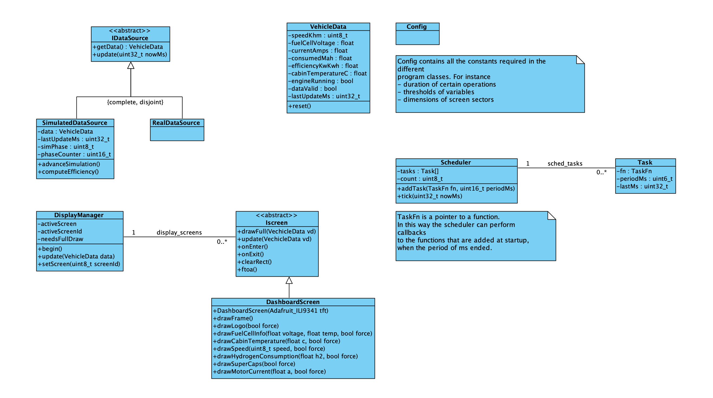
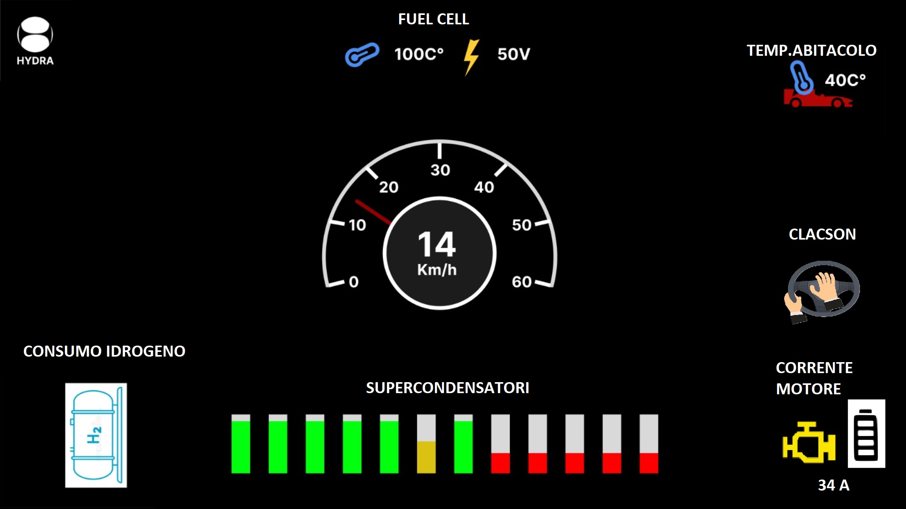

# Dashboard

Firmware del cruscotto Hydra.



## Target

| Env | Scheda | Display | Driver |
|---|---|---|---|
| `esp32` (default) | ESP32 DevKit | ILI9488 480×320 | TFT_eSPI |
| `wokwi` | ESP32 simulato | ILI9341 | Adafruit ILI9341 |
| `uno` | Arduino Uno | ILI9341 | Adafruit ILI9341 |

Il target è scelto con `-DTARGET_BOARD` in `platformio.ini` (vedi `src/config/DisplayConfig.h`).

## Pin ESP32 → ILI9488

| Segnale | GPIO |
|---|---|
| MOSI | 23 |
| MISO | 19 |
| SCLK | 18 |
| CS | 15 |
| DC | 2 |
| RST | 4 |

Cablaggio per il simulatore Wokwi (ILI9341): [`docs/assets/wiring-wokwi.png`](../docs/assets/wiring-wokwi.png).

## Struttura

```
src/
├── main.cpp            scheduler dei task (sensori 20 ms, display 100 ms)
├── config/             costanti, layout del display, selezione scheda
├── data/               sorgenti dati (IDataSource): simulata ora, reale via Serial1 in futuro
├── display/            DisplayManager + schermate (IScreen)
├── input/              gestione pulsanti
├── scheduler/          scheduler cooperativo senza heap
└── assets/logo.h       logo in RGB565
```

I dati del veicolo (`VehicleData`) stanno in [`../lib/hydra-protocol`](../lib/hydra-protocol).
Per passare dai dati simulati a quelli reali cambia `dataSource` in `main.cpp`.

## Layout del display


